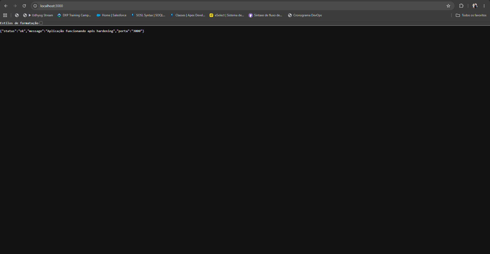
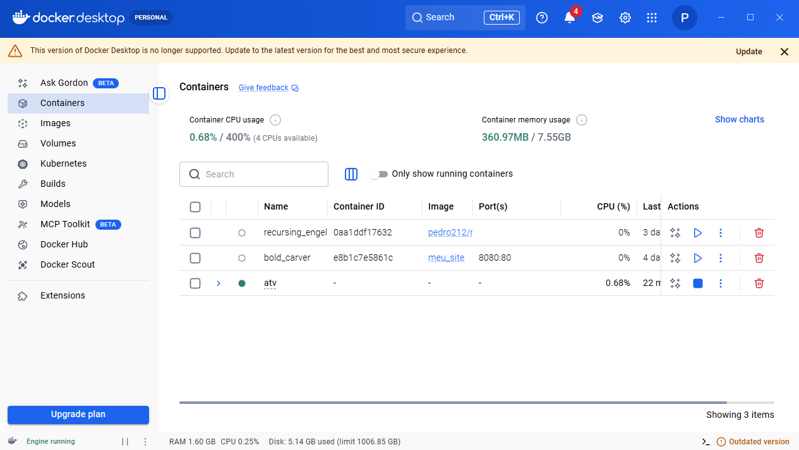

# Hardening do ambiente Docker

## 1. Problemas encontrados

- Imagem base: a tag `latest` não é fixa, o que torna a imagem instável e dificulta rastrear as mudanças de segurança, além disso, ela é maior e trás mais componentes do que o necessário.
- Instalação de dependências sem controle de versão: a imagem instalava `nodejs` e `npm` com `apt-get`, sem remoção de pacotes desnecessários.
- Exposição de portas para o host: o banco de dados ficava acessível em `3306` para a máquina hospedeira, mas era utilizado apenas pela aplicação.
- Credenciais hardcoded: a senha do banco estava diretamente no `Dockerfile`, o que expõe secrets em camadas da imagem e em artefatos versionados.
- Aplicação executada como root: qualquer comprometimento do container teria acesso de administrador ao sistema do contêiner.
- Ausência de limites de recursos: os containers não possuíam limites de CPU e memória, podendo causar consumo excessivo e indisponibilidade do host.
- Comunicação direta e pública dos serviços: o `docker-compose.yml` não separava os serviços em rede privada e expunha portas desnecessárias.

## 2. Medidas aplicadas

As correções realizadas foram:

- Substituição da imagem base por `node:20-bookworm-slim`, que é menor, mais específica e adequada para execução de aplicações JavaScript.
- Remoção do uso de `ubuntu:latest` e do comando `apt-get install` no Dockerfile, reduzindo a superfície de ataque.
- Execução da aplicação como usuário `node`, com privilégios mínimos para a operação do serviço.
- Arquivo `.env` para armazenar segredos locais e uso de `env_file` no `docker-compose.yml` para carregar variáveis de ambiente sem expô-las no código ou na imagem.
- Arquivo `.env.example` com a estrutura das variáveis necessárias, sem valores reais.
- Configuração do `.gitignore` para bloquear o envio do `.env` para o Git.
- Restrição da porta exposta do banco para `127.0.0.1`, mantendo apenas a aplicação acessível externamente.
- Isolamento dos serviços em uma rede dedicada `app-network` e remoção da publicação desnecessária da porta do banco.
- Limites de CPU e memória para os serviços app e banco, para controlar consumo excessivo de recursos.
- Habilitação de `no-new-privileges` e `cap_drop: ["ALL"]` para reduzir o impacto de um evento de comprometimento.

## 3. Análise final

1. Qual era o principal risco encontrado no projeto?

A combinação de credenciais expostas em imagem, execução como root e exposição desnecessária de serviços.

2. Qual alteração de hardening foi mais importante? Por quê?

A remoção de privilégios administrativos e a eliminação de secrets em arquivos versionados foram as mudanças mais importantes, porque reduziram o dano potencial de um atacante e a chance de vazamento de credenciais.

3. O que poderia acontecer caso o container da aplicação fosse comprometido?

Um atacante poderia explorar o processo da aplicação para obter controle do container, alterar arquivos, ler segredos, movimentar-se pela rede local, comprometer o banco de dados e outros serviços conectados e etc.

4. Como o princípio do menor privilégio foi aplicado?

A aplicação foi executada como usuário `node` em vez de `root`, e os containers receberam apenas os acessos, capacidades e portas estritamente necessários (minimamente).

5. Por que o `.env` não deve ser enviado para o repositório?

Porque ele contém segredos e credenciais reais que não devem ficar versionados, pois podem ser expostos em logs, backups, pull requests e repositórios públicos ou compartilhados.

6. Qual é a função do `.env.example`?

É um modelo de referência para os nomes das variáveis ambientais necessárias, permitindo que outros desenvolvedores configurem seu ambiente local sem expor os valores reais.

7. Como o projeto poderia receber novas verificações de segurança automaticamente em uma pipeline CI/CD?

Através de etapas automatizadas de lint, validação de Dockerfile, verificação de imagens com ferramentas como Trivy, testes de composição com `docker compose config` e checklists de segurança antes do merge.

8. Quais medidas adicionais poderiam ser aplicadas caso essa aplicação fosse executada em Kubernetes?

- uso de `PodSecurityAdmission` ou políticas de segurança de namespace;
- utilização de `readOnlyRootFilesystem` quando possível;
- definição de `runAsNonRoot`, `allowPrivilegeEscalation: false` e recursos de rede/CPU/memória;
- autenticação e controle de acesso com RBAC;
- image scanning em registro e validação de vulnerabilidades antes do deploy.

## Evidências de validação

A aplicação foi validada com a construção e execução do ambiente local com Docker Compose. A composição foi testada com `docker compose config` e a aplicação respondeu corretamente em `http://localhost:3000` com status `200`.

